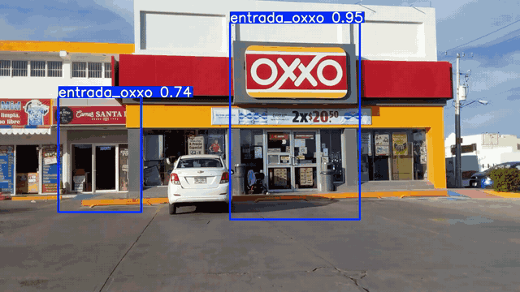
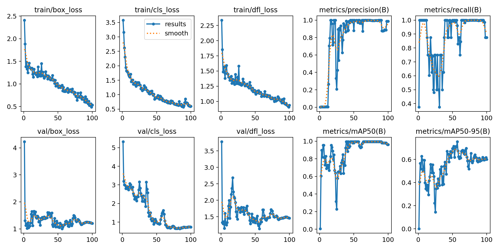
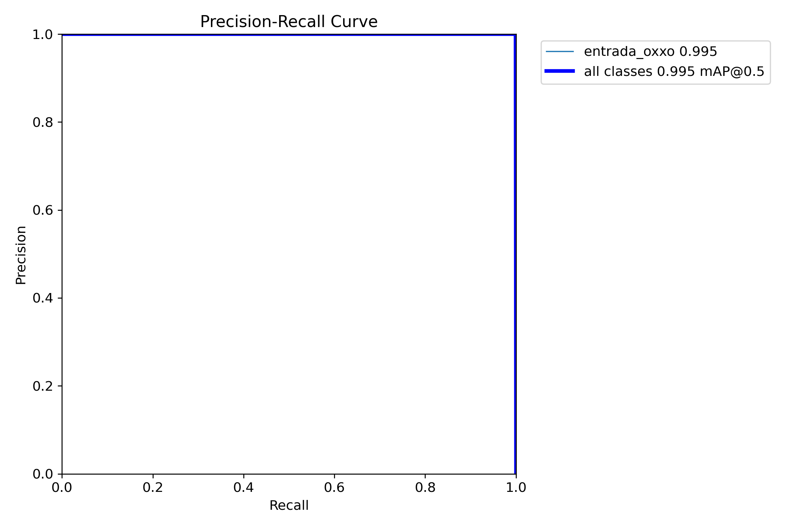
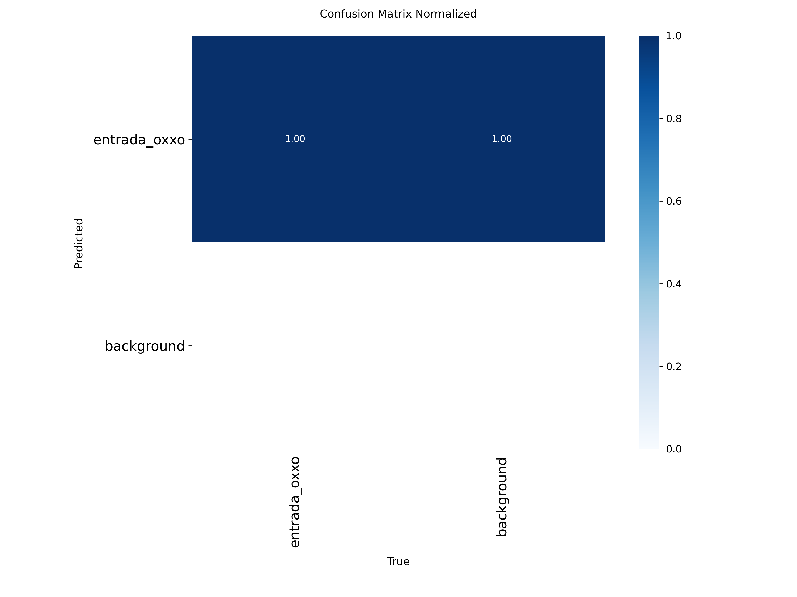
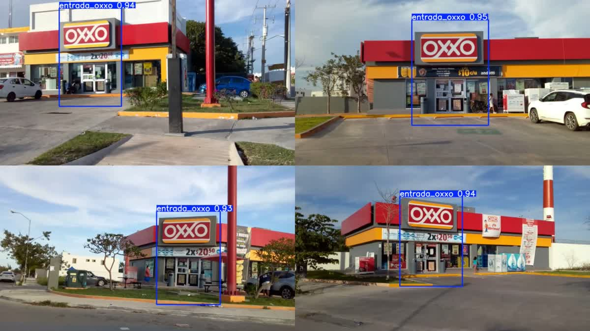

# Detección de entradas de OXXO con YOLOv12

Detector de objetos que localiza la **entrada de tiendas OXXO** en fotos y video. Se entrenó un modelo
**YOLOv12n** (Ultralytics) por *fine-tuning* sobre un dataset propio de 81 imágenes etiquetadas en Roboflow,
y se probó sobre un video grabado en Mérida, Yucatán.

Proyecto de la materia *Tópicos Selectos de IA* (8.º semestre, Ingeniería en Sistemas Computacionales, Instituto
Tecnológico de Mérida).



## Resultados

Entrenamiento: 100 épocas, imágenes de 640 px, lotes de 16, GPU de Google Colab (~3.5 min).

| Métrica (validación) | Mejor modelo (`best.pt`, época 57) | Última época (100) |
|---|---|---|
| Precisión | 1.00 | 0.99 |
| Recall | 0.96 | 0.88 |
| mAP@50 | **0.995** | 0.962 |
| mAP@50-95 | **0.754** | 0.600 |

- En video, el modelo detecta la entrada en **626 de 673 cuadros** (93 %) con confianza ≥ 0.6, a ~20 ms por cuadro en la
  GPU de Colab.
- **Limitación:** el conjunto de validación tiene solo 8 imágenes, así que las métricas son orientativas. Con más
  imágenes (otras ciudades, de noche, con lluvia, de lado) el resultado sería más confiable.

| Curvas de entrenamiento | Precisión-Recall | Matriz de confusión |
|---|---|---|
|  |  |  |

Ejemplos (cuadros del video de Mérida):



## Estructura

```
oxxo-detection-yolo12/
├── notebooks/
│   ├── 01_entrenamiento.ipynb   # entrena YOLOv12n y evalúa en el conjunto de prueba
│   └── 02_inferencia.ipynb      # usa weights/best.pt en imágenes y video
├── weights/best.pt              # modelo entrenado (5 MB)
├── dataset/data.yaml            # configuración del dataset (rutas relativas)
├── results/                     # métricas y gráficas del entrenamiento
├── examples/, demo/             # detecciones de ejemplo y GIF del video
└── requirements.txt
```

## Cómo usarlo

**En Google Colab** (recomendado, con GPU): abre un notebook desde GitHub en Colab y corre las celdas en orden; la
primera clona este repositorio.

**En local:**
```bash
git clone https://github.com/DimoltoSs/oxxo-detection-yolo12.git
cd oxxo-detection-yolo12
pip install -r requirements.txt
jupyter notebook notebooks/02_inferencia.ipynb
```

Uso directo desde Python:
```python
from ultralytics import YOLO

model = YOLO("weights/best.pt")
model.predict("mi_foto.jpg", conf=0.5, save=True)
```

### Dataset

Las imágenes no están en el repositorio. Descárgalas de
[Roboflow Universe](https://universe.roboflow.com/angels-workspace-jvtq0/oxxo_detection/dataset/1) en formato
**YOLOv12** y pon las carpetas `train/`, `valid/` y `test/` dentro de `dataset/`.

- 81 imágenes (61 de entrenamiento, 8 de validación y 12 de prueba), una clase: `entrada_oxxo`.
- Etiquetado propio en Roboflow; sin aumentos de datos.

## Tecnologías

Python · [Ultralytics](https://docs.ultralytics.com/) 8.3.232 (YOLOv12n) · PyTorch · Roboflow · Google Colab

## Créditos y licencias

- **Modelo base:** YOLOv12n preentrenado de [Ultralytics](https://github.com/ultralytics/ultralytics), con licencia
  AGPL-3.0. Los pesos entrenados (`weights/best.pt`) son una obra derivada y quedan bajo esa misma licencia.
- **Dataset:** etiquetado por el autor y publicado en Roboflow (CC BY 4.0). Algunas imágenes se tomaron de capturas de
  Google Street View, cuyos derechos son de Google; por eso no se incluyen en este repositorio.
- **Video de demostración:** grabado en Mérida, Yucatán.
- OXXO es una marca registrada de su titular. Este es un proyecto académico, sin relación con la empresa.

## Autor

Angel Josué López Castilla · [@DimoltoSs](https://github.com/DimoltoSs)
